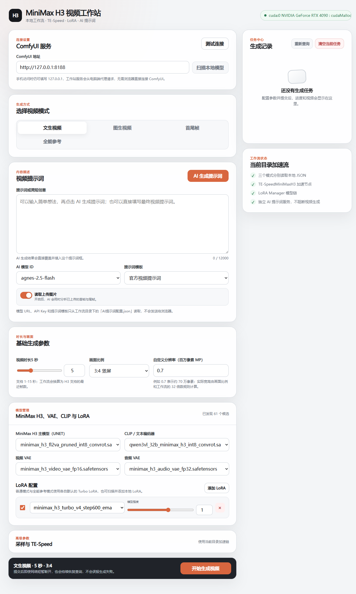

<div align="center">
有问题可以加我的QQ群：1062979770反馈，整合包三视图等等资源都在群里哦！建议使用我配置好的整合包环境使用，不然可能会在装节点和环境依赖等问题卡壳。
  
# 🎬 MiniMax H3 视频工作站

**MiniMax H3 Workstation UI** — 面向本地 ComfyUI 的 MiniMax H3 一键视频生成工作站。

支持文生视频 · 图生视频 · 首尾帧 · 全能参考（图片/视频/音频）等生成模式，集成 **TE-Speed 加速**、**LoRA 管理与加速链**、**AI 提示词生成**，并内置一个轻量的 PowerShell Web 服务，一台电脑即可同时服务浏览器与手机端。

</div>

---

## 🖼️ 界面预览

<div align="center">
  
</div>

<div align="center"><em>左：桌面端（模型管理 / TE-Speed / 任务中心） · 右：移动端 AI 提示词界面</em></div>

---

## ✨ 功能特性

- 🎞️ **五种生成模式**：文生视频（T2V）、图生视频（I2V）、首尾帧、全能参考（图片 + 视频 + 音频多模态组合，图片最多 9 张 / 视频 3 段 / 音频 3 段，合计 12 个素材）、**长视频导演台**（TimelineDirector 分镜工作流，支持多分镜拼接出长视频 + 二采超分，提示词与参考素材 —— 图片 / 视频 / 音频 —— 自动写进 `timeline_data`）。
- 🚀 **TE-Speed 加速**：默认接入 TE-SpeedMiniMaxH3 加速节点，支持灵活调整加速控制值、区间起点与终点。
- 🧩 **LoRA Manager 加速链**：扫描并选择本地 LoRA，普通模式与全能参考模式分别管理默认 Turbo LoRA；支持多 LoRA 叠加。
- 🤖 **AI 提示词生成**：填写一句话创意即可让 AI 模型生成结构化视频提示词（OpenAI 兼容 `/chat/completions` 接口），支持视觉模型**读取上传的首帧 / 尾帧**进行多模态分析；云端 API 与本地模型（LM Studio / Ollama 等 OpenAI 兼容服务）均可接入，且为独立服务，**不阻断视频生成**。
- ↩️ **提示词撤回**：AI 生成结果会覆盖提示词框，一键「撤回」即可恢复到生成前的输入——模型拒答时不再丢失你写的原稿。
- 🖱️ **文件拖拽上传**：图片 / 视频 / 音频直接拖入页面即可上传。首尾帧模式一次拖两张自动分配首帧与尾帧；全能参考模式混合拖入时自动按类型归类。
- 🧩 **可选节点自动降级（兼容性）**：RTX 视频放大、TE-Speed、LoRA Manager 都属于「可选」节点。工作站在连接时会探测 ComfyUI 实际装了哪些节点，**缺哪个就自动跳过对应环节并继续出片**——没装 RTX 节点包时按原分辨率输出、没装 TE-Speed 时跳过加速、没装 LoRA Manager 时跳过 LoRA，同时把原因常驻显示在「高级参数」里。不会因为缺少非关键节点而整单失败。
- 💾 **五种模式统一使用 ComfyUI 官方保存节点**：文生 / 图生 / 首尾帧、全能参考与长视频导演台的输出节点都是 ComfyUI **内置**的 `SaveVideo`，不依赖任何第三方节点即可出片。
- 🔍 **环境自检**：右侧常驻面板按生成模式列出「必需 / 可选」节点的缺失情况，一眼看出哪个模式不可用、哪个只是降级；缺失节点按所属节点包合并，直接给安装方式 —— 装了 **ComfyUI-Manager** 时是「一键安装」，没装则回退成复制 `git clone` 命令手装，两种情况下都附仓库链接。面板反映 ComfyUI 的**实际安装情况**，并且明确区分「连不上 ComfyUI」与「缺节点」两种情况。**仓库地址由服务端登记表提供，请求只带包名**，不会去安装名单之外的仓库。
- 🔄 **检查更新与一键更新**：自动检测 GitHub 仓库是否有新版本（6 小时节流，也可点右上角「检查更新」手动检查），发现新版本弹出横幅；一键更新自动下载、替换文件并重启服务，`AI提示词配置.json` 等个人配置自动保留。
- 🧹 **自动清理显存 + 手动一键清理**：「高级参数」内置滑动开关（默认开启）。**视频生成完成后**，网页会先确认 ComfyUI 队列是否空闲：空闲就调用官方 `/free` 接口卸载模型释放显存；队列里还有任务在跑或排队则自动跳过，等最后一个任务结束后再清理——既不打断连续排队生成，也规避了 comfy-aimdo 动态显存加载下 `hostbuf_file_reader_read failed` 的问题。旁边另有「立即清理显存」按钮，可随时手动释放显存（队列繁忙时会拒绝并提示，不打断生成）。
- 🗂️ **本地工作流 JSON**：三种基础模式分别读取当前目录下的独立 JSON 工作流，参数由服务端注入，前端无需直接构造 ComfyUI 工作流。
- 🌐 **浏览器 + 手机端**：内置 PowerShell Web 服务（默认 `http://127.0.0.1:8000`），桌面浏览器可直接访问，手机可通过局域网访问同一地址；ComfyUI 请求由服务端代理，手机端无需直连 `8188` 端口。
- 🔍 **模型扫描**：一键扫描本地 UNET / CLIP / VAE / LoRA 模型并在下拉框中选用。
- ✅ **任务中心**：生成进度实时查询，网络短暂断开也能自动恢复轮询，不会误报失败。

---

## 📁 目录结构

```
MiniMax-H3-Workstation-UI/
├── 启动工作站.bat                 # 双击入口（**必须保持纯 ASCII**，见下方说明）
├── launch.ps1                     # 启动逻辑主体：清理旧进程 → 起服务 → 等就绪 → 开浏览器
├── server.ps1                     # 核心 Web 服务（HTTP 监听 + ComfyUI 代理 + AI 提示词服务）
├── index.html                     # 主界面（单页应用）
├── favicon.svg                    # 站点图标
├── assets/
│   ├── workstation.css            # 界面样式
│   └── workstation.js             # 前端逻辑
├── AI提示词配置.example.json       # AI 提示词服务配置模板（空 Key，复制为 AI提示词配置.json 后填写）
├── AI提示词配置.json               # 本地实际生效的配置（含真实 Key，已加入 .gitignore，不随仓库分发）
├── 更新配置.json                  # 更新检测配置（GitHub 仓库 / 当前版本 / 更新时保留清单）
├── .gitignore                     # 忽略本地真实配置、记忆目录与审查产物
├── minimaxH3文生视频基础加速流.json     # 文生视频工作流
├── minimaxH3图生视频基础加速流.json     # 图生视频工作流
├── minimaxH3首尾帧视频基础加速流.json    # 首尾帧视频工作流
├── minimaxh3全能参考(图片+视频+音频)+ai提示词生成+加速+Lora.json  # 全能参考工作流
└── minimaxH3长视频导演台加速流.json    # 长视频导演台工作流（分镜 + 二采超分，UI 格式，服务端提交前自动转 API）
```

> ⚠️ **`启动工作站.bat` 必须保持纯 ASCII —— 千万不要往里面写中文。**
> cmd.exe 在代码页 65001 下解析批处理文件时按**字节偏移**回退读取，遇到多字节字符会从字符中间切断，
> 把一行拆成两半，后半截随即被当成命令执行，终端里就会冒出一串
> `'……' is not recognized as an internal or external command`。
> 所有中文提示与启动逻辑都放在 `launch.ps1`（PowerShell 读 UTF-8 脚本没有这个问题）。
> 同理，改动 `launch.ps1` 时请保持 **UTF-8 带 BOM + CRLF** 保存，否则 PowerShell 5.1 会把中文读成乱码。

---

## 📋 环境要求

- **Windows** 系统（脚本基于 PowerShell，`启动工作站.bat` 依赖 Windows 命令）。
- 已安装并启动 **ComfyUI**（默认 `http://127.0.0.1:8188`）。**需要较新版本**（本项目在 **0.34.5** 上验证）：MiniMax H3 的主节点（`MiniMaxH3ImageToVideo` / `MiniMaxH3ReferenceToVideo`）以及 `ResolutionSelector`、`ComfyMathExpression`、`PrimitiveFloat` 等由 ComfyUI **内置**（`comfy_extras`）提供，版本过旧时提交会直接报 `missing_node_type`。
- 已就绪 MiniMax H3 相关模型（放到对应 ComfyUI 目录）：
  - 主模型（UNET）→ `models/diffusion_models`
  - CLIP / 文本编码器 → `models/clip`
  - 视频 VAE / 音频 VAE → `models/vae`
  - LoRA → `models/loras`
- 另需以下 ComfyUI 自定义节点（MiniMax H3 主节点由 ComfyUI 内置提供，不在此列）：
  - **TE-SpeedMiniMaxH3**（加速节点，位于普通工作流与全能参考工作流中）
  - **ComfyUI-LoraManager**（LoRA 加速链）
  - **ComfyUI-Easy-Use**（可选。仓库自带工作流 JSON 里包含其 `easy cleanGpuUsed` 清理节点，仅在 ComfyUI 画布中直接运行这些工作流时需要；网页端提交时服务端会自动移除该节点，显存清理改走 ComfyUI 官方 `/free` 接口）
  - **VideoHelperSuite**（仅「全能参考」模式提交视频参考时使用，用于把视频转为帧序列）
  - **ComfyUI-MiniMaxH3-TimelineDirector**（仅「长视频导演台」必需，提供时间线/分镜规划与分段采样；缺失时该模式会明确提示）
  - **ComfyUI-KJNodes**（「长视频导演台」链路使用 `MiniMaxLowVRAMAttention`、`MiniMaxChunkFeedForward`、`PathchSageAttentionKJ`，缺失会自动从链上摘除并重连）
  - **ComfyUI-YCNodes-MiniMax-H3**（「长视频导演台」使用 `H3SigmaRefiner` 追加精修步，缺失会自动跳过）
- 使用 AI 提示词功能时，需要可访问的 OpenAI 兼容接口服务与对应 **API Key**。

> 💡 **关于上面这些自定义节点**：除 ComfyUI 内置节点外，其余都是**可选**的。工作站连接时会探测 ComfyUI 实际拥有的节点，缺少时自动降级（跳过 RTX 放大 / TE-Speed 加速 / LoRA）并在「高级参数」里给出提示，不会因此无法生成。只有 ComfyUI 版本过旧、缺少内置的 MiniMax H3 主节点时才会真正不可用（会明确提示需要更新 ComfyUI）。
>
> 关于保存节点：五种模式的输出节点统一使用 **ComfyUI 官方内置**的 `SaveVideo`，不需要安装任何第三方保存节点。

---

## 🚀 快速开始

1. **准备环境**：如上安装并启动 ComfyUI，放置好 MiniMax H3 模型及所需自定义节点。
2. **填写 AI 配置（可选）**：把 `AI提示词配置.example.json` 复制为 `AI提示词配置.json`，在其中填写「AI 语言模型」的 URL 与 API Key，并按需调整提示词模板（`AI提示词配置.json` 已加入 `.gitignore`，不会被误提交）。
3. **启动工作站**：双击运行 `启动工作站.bat`。
   - 脚本会自动申请管理员权限以开放局域网访问；
   - 启动后浏览器将自动打开工作台地址（默认 `http://127.0.0.1:8000/`）。
4. **连接并生成**：
   - 在「ComfyUI 服务」中确认地址为你的 ComfyUI（默认 `http://127.0.0.1:8188`），点击「测试连接」；
   - 点击「扫描本地模型」选择主模型 / CLIP / VAE / LoRA；
   - 选择生成模式、填写提示词（或点击「AI 生成提示词」自动生成）、设置时长与画面比例；
   - 点击「开始生成视频」，在右侧任务中心查看进度与成片。

> 💡 **手机访问**：手机连接与电脑同一局域网，直接访问终端显示的局域网地址（如 `http://192.168.x.x:8000/`）即可，无需在手机端填写 ComfyUI 地址（请求由电脑端服务代理）。

---

## ⚙️ 配置说明

### AI 提示词配置（`AI提示词配置.json`）

该文件用于配置网页中的「AI 生成提示词」功能，修改后重启工作站服务即可生效。首次使用请把仓库内的 `AI提示词配置.example.json` 复制为 `AI提示词配置.json`：

- `模型`：可配置多个模型，每个含 `id`、`url`（API 根地址或完整 `/chat/completions` 地址）、`api_key`、`supports_images`（是否支持读取图片）、`retry_count`（失败重试次数）等字段。支持任意 OpenAI 兼容服务，包括本地模型：LM Studio 填 `http://<IP>:1234/v1`，Ollama 填 `http://<IP>:11434/v1`（`api_key` 随意填写即可）。
- `提示词模板`：可配置多个系统提示词模板，例如「官方视频提示词」「动漫动作导演」「动态壁纸」等。
- 网页只会读取模型的 `id` 与模板的 `name`，**不会**把 `url` / `api_key` 暴露给浏览器。

> ⚠️ **安全提示**：仓库内只提供 `AI提示词配置.example.json`（空 Key 模板）；`AI提示词配置.json` 已加入 `.gitignore`，不会被提交。**请勿**把它从忽略列表里移出后提交到公网仓库。若曾把含真实 Key 的版本推到过远端，建议直接轮换这些 Key。

### 更新检测配置（`更新配置.json`）

一键更新功能以本文件为配置源，日常使用无需手动维护（更新成功后会自动改写版本号）：

- `GitHub仓库`：格式 `用户名/仓库名`，也支持填写完整 GitHub 地址；更新检测以此为源。
- `当前版本`：本地对应的提交 SHA，与仓库 main 分支最新提交比对判断是否有更新。
- `分支`：默认 `main`。
- `更新时保留的文件`：一键更新时不被覆盖的文件列表，默认保留 `AI提示词配置.json` 与 `更新配置.json`，其余文件以仓库版本为准（只增改、不删除本地多出的文件）。

### 端口与环境变量

- 服务默认端口 `8000`，可通过环境变量 `WORKSTATION_PORT` 覆盖。
- ComfyUI 默认地址 `http://127.0.0.1:8188`，可在界面「ComfyUI 服务」中修改。

---

## 🏗️ 技术栈 / 架构

| 层 | 技术 |
| --- | --- |
| 前端 | 原生 HTML / CSS / JavaScript 单页应用（移动端与桌面端自适应） |
| 后端 | PowerShell `System.Net.HttpListener` HTTP 服务（无第三方依赖） |
| 视频生成 | ComfyUI + MiniMax H3 工作流（TE-Speed / LoraManager / VHS 等自定义节点） |
| AI 提示词 | OpenAI 兼容 `/chat/completions` 接口（支持视觉多模态） |

服务端负责：静态资源托管、ComfyUI 请求代理、工作流参数注入、模型扫描、任务进度轮询、视频预览代理与 AI 提示词调用。

---

## 🕘 更新日志

### v20260921-12 · 「一键安装」缺失节点包（2026-09-22）

- ⚡ **自检面板的节点包卡片支持一键安装了**：检测到 **ComfyUI-Manager** 时卡片上多出「一键安装」主按钮，点一下就把该节点包装好；没装 Manager 时保持原来的「复制安装命令」。两条路都保留「打开仓库」，一键安装失败时手动命令是兜底。
- 🔒 **安全边界（本功能最关键的设计）**：请求体里**只允许出现包名**，仓库地址由服务端从自检登记表反查 —— 前端无法指定任意 URL，所以这个接口不可能被诱导去安装登记表之外的仓库。实测浏览器发出的请求体是 `{"package":"ComfyUI-MiniMaxH3-TimelineDirector"}`，**不含任何 `github.com` 字符串**。另与「一键更新」守同一套闸：要求 `application/json`（跨站表单发不出该 Content-Type，挡住 CSRF）+ 同源校验。
- 🩺 **转发给 ComfyUI-Manager 的 `POST /customnode/install/git_url`**（接口清单取自 Manager 源码 `glob/manager_server.py`，非推断）。Manager 用它自己的安全策略把关，本站不绕过、也没法绕过。
- 💬 **把 Manager 的拒绝原因翻译成人话**：它的 403 会返回机器可读的 `flag_token`，直接抛给用户只会看到一个英文标识符，现在分别译成：
  - `allow_git_url_install` → Manager 未开启 Git URL 安装，或 ComfyUI 不是以本机（loopback）模式启动 → 请改用「复制安装命令」；
  - `comfyui_outdated` → ComfyUI 版本过旧，请先更新；
  - `security_level` → 请在 Manager 面板调整安全等级后重试。
- 🧩 **内置节点不可一键安装**：`comfy-core` 一类的缺失会明确回「请更新 ComfyUI，而不是安装节点包」。
- 🐞 **测试抓到一个真实缺陷并已修复**：`comfy-core` 是汇总时给内置节点现起的**合成包名**（登记表里内置条目的 `Package` 字段是空串），所以初版 `Get-InstallablePackage 'comfy-core'` 查不到它，会回含糊的「不在可安装清单里」而不是「请更新 ComfyUI」。已显式识别该合成名。
- ✅ 验证：后端离线测试扩到 **25 条断言**（新增 9 条安装闸门用例，含「把 URL 当包名传进来必须被拒绝」「空包名必须被拒绝」）；前端烟测扩到 **6 个场景**，新增「装了 Manager」（断言出现「一键安装」）与「没装 Manager」（断言按钮消失、退回复制命令），并**实际点击一键安装**、断言请求体只含包名。全部通过，0 个 JS 报错。
- 🔧 静态资源版本号同步为 `20260921-12`（`server.ps1` 与前端都改了，**需重启工作站服务**）。

### v20260921-11 · 新增「环境自检」面板（2026-09-22）

- 🔍 **把右侧那张写死的「工作流状态」卡片换成了真实的环境自检面板**。原先那四条 ✓ 是硬编码的（文案还停在「三个模式」），永远全绿、从不反映真实情况；现在它由 `GET /api/self-check` 驱动，逐模式报告缺什么。
- 📋 **按生成模式分组**，一眼看出**哪个模式不能用、哪个只是降级**：
  - 缺「必需」节点 → 该模式不可用（例：缺 `MiniMaxH3TimelinePlanner` → 长视频导演台不可用）；
  - 缺「可选」节点 → 只降级，**仍会正常出片**（例：缺 TE-Speed → 生成变慢，结果正常）；
  - 面板常驻一句说明点破「降级 ≠ 不能用」—— 否则只缺一个 RTX 放大就会让五个模式集体变黄，容易被误判成环境装坏了。
- 📦 **给出安装指引**：缺失节点按**所属节点包**合并（KJNodes 的三个节点并成一条），每条带「复制安装命令」（`git clone <仓库>`）与「打开仓库」。
  - 仓库地址只在**确信时**填写；未登记来源的节点单独列出并提示「在 ComfyUI-Manager 中按节点名搜索」—— 宁可不给，也不给错地址。
  - ComfyUI **内置**节点缺失时单独成条，提示「更新 ComfyUI」而不是「装包」：那本来就不是装包能解决的。
  - 剪贴板有兜底：用局域网 IP 访问时 `navigator.clipboard` 拿不到，会退化成把命令显示出来让用户手抄，而不是静默失败。
- 🔌 **「连不上 ComfyUI」与「缺节点」分开显示**：ComfyUI 没启动时面板只报连接失败并给出原因，不会满屏红叉让人以为节点装崩了。
- ⚠️ **只读诊断，绝不阻断生成**：缺可选节点仍然照旧降级出片，这个面板只负责把事实讲清楚。任何情况下都不会变成「环境不达标就不给点生成」。
- 🐞 **顺手修掉一个既有问题**：前端 `CAPABILITY_ITEMS` 只登记了 10 项，**漏掉了导演台的全部专属节点**（TimelinePlanner / FiniteSegmentSampler / H3SigmaRefiner / SageAttentionKJ / MiniMaxLowVRAMAttention / MiniMaxChunkFeedForward），导致导演台缺节点时「高级参数」里**一条提示都没有**。自检面板覆盖全部 17 项探测结果。
- ✅ 验证：离线跑真实的 `Get-SelfCheckReport`（AST 抽注册表与函数），8 组缺失组合 / **16 条断言全过**；前端烟测 5 个场景（全装 / 缺导演台 / 未连接 / 缺 RTX / 缺内置节点）**全过且 0 个 JS 报错**。
- 🔧 静态资源版本号同步为 `20260921-11`（`server.ps1` 与前端都改了，**需重启工作站服务**）。

### v20260921-10 · 导演台分镜改回官方重叠几何（2026-09-22）

- 🚨 **修复 · 分镜段间帧范围与官方不一致**：本项目此前按「无缝累加」排布分镜（第 2 段紧接第 1 段末尾），而节点包 `js/segment_windows.mjs` 的 `createWindows` **默认让相邻两段重叠 39 帧**：
  - `overlap` 的默认参数就是字面量 `39`，且只有首段取 `0`；
  - 官方单测 `createWindows([],4,243)` 断言 `startFrame === [0, 204, 408, 612]` —— 步长 `204 = 243 − 39`；
  - 官方示例工作流 `example_workflows/…导演台工作流.json` 里两段是 `{0,192}` 与 `{153,396}`，`192 − 153 = 39`；
  - `editWindow()` 的注释明确要求 "preserve existing seam overlaps"。

  这段重叠是**跨段承接**用的。按无缝实现会让成片比官方长、且段边界缺少承接区间。
- ✅ **改为官方几何**：两段各 10 秒从「`[0,243] [243,486]`，共 20.25 秒」变为「`[0,243] [204,447]`，**共 18.63 秒**」。重叠值同样走官方 `nearestOverlap` 的吸附规则（候选 `0 / 1 / 5+17n`），因此**段很短时重叠会自动退到 22 / 5 / 1 / 0**，不会排出「重叠比段还长」的非法窗口（例：两段各 1 秒时重叠退为 5，窗口 `[0,22] [17,39]`）。
- 🔧 前端 `directorTotalSeconds()` 同步改用同一套几何（取最后一段的结束帧 ÷ 24，不再把各段秒数简单相加），界面显示的「共约 X 秒」与实际成片一致。
- 📌 注：官方约束只要求「首段 `startFrame = 0`」与「每段 `5+17n` 帧」，无缝与重叠**都能通过校验** —— 所以本条是**行为对齐**，不是崩溃修复。
- ✅ 验证：离线跑真实的 `Build-DirectorWorkflow`（AST 抽函数 + 桩掉 ComfyUI 依赖）与从 `workstation.js` 提取出的同名函数，六组场景逐一比对，**前后端输出完全一致**；浏览器烟测 **0 个 JS 报错**，2 段各 5 秒显示「共约 8.71 秒」（= 209 帧 ÷ 24，旧算法会显示 10.33 秒）。
- 🔧 静态资源版本号同步为 `20260921-10`（`server.ps1` 与前端都改了，**需重启工作站服务**）。

### v20260921-9 · 修复参考视频被静默丢弃（2026-09-22）

- 🚨 **修复 · 导演台上传的参考视频此前完全不生效**：节点侧 `minimax_h3_finite_segments.py` 对 `videoClips` 有两道**硬过滤**：

  ```python
  clips = [clip for clip in timeline.get("videoClips", [])
           if isinstance(clip, dict) and clip.get("file")
           and clip.get("hasAudio", True) is not False      # ← 显式 false 直接丢弃
           and float(clip.get("duration") or 0.0) > 0.0]    # ← 时长读不出也丢弃
  ```

  而 v20260921-4 实现时两处都踩了：`hasAudio` 被硬编码成 `false`（当时想"保守"），`duration` 在浏览器读不出时会传 `0`。**结果是参考视频被节点静默剔除、完全不参与生成，且没有任何报错**——上传了却什么也没发生。

  现在：`hasAudio` 跟随官方默认值 `true`（官方网页的归一化就是 `c.hasAudio !== false`）；`duration <= 0` 时兜底成 **5 秒**（与节点侧 `num(c.duration, 5)` 默认值一致），宁可截短也不整条丢掉；浏览器读不出时长时会明确提示用户（建议换标准编码的 MP4）。
- 附带效果：由于 `hasAudio` 不再被强制为 false，参考视频的**原声**现在会参与混音（配合 `videoAudioEnabled: true`）。
- ✅ 验证方式：在离线注入测试里**复刻节点侧那两道过滤条件**，断言生成的 `videoClips` 能通过 —— 修复前 `0/1`（全被丢弃），修复后 `1/1` 存活。
- 🔧 静态资源版本号同步为 `20260921-9`（`server.ps1` 与前端都改了，**需重启工作站服务**）。
- ⚠️ **更正（2026-09-22，复核节点包源码后）**：本条对过滤条件**作用范围**的描述有误。那段 `hasAudio` 过滤位于**音频规格**函数内（同函数开头先判 `videoAudioEnabled`），而**视频画面**走的是 `minimax_h3_timeline_director.py` 里只要求 `clip["file"]` 的路径。所以 `hasAudio = false` 只会让该视频**不参与源声混音**，并不会让整条参考视频被丢弃。结论：当前把 `hasAudio` 设为 `true` 仍然正确（与官方 JS 归一化 `c.hasAudio !== false` 一致，且 `_decode_audio` 解不出音轨时会 `continue` 兜底），**无需再改**。

### v20260921-8 · 分段素材勾选项加预览小图（2026-09-22）

- 🎨 **分段卡片里的「本段参考图片」现在直接显示缩略图**：用 `URL.createObjectURL` 读本地文件出真实画面，一眼就能认出是哪张；**音频**没有画面，用音符 `♪` 占位。**未勾选**的素材整块压暗（`opacity: .5`），这一段的取舍一目了然。
  - 缩略图的 blob URL 记在 `data-preview-url` 上，`renderDirectorSegments()` 重建前统一 `revokeObjectURL` —— 分段卡会随素材增删、模式切换频繁重建，不回收的话每重建一次就漏一批。
  - 注：**参考视频没有分段级选择器**，因为 `timeline_data` 里 `videoClips` 是全局的（不像 `segments[].images`/`audios` 挂在段上），所以视频没有对应的缩略图可加。
- 📌 顺带记录一个既有行为（非本次引入）：参考素材**批量添加时若有一张不合规，整批会被回滚**（例如宽高比不在 5:2 ~ 2:5 范围内），已合规的那些也不会留下，只弹一条说明。如果希望改成"逐张跳过不合规的、保留合规的"，说一声即可调整。
- 🔧 静态资源版本号同步为 `20260921-8`。

### v20260921-7 · 分段素材允许"一项都不引用"（2026-09-22）

- 🐛 **修复 · 分段素材被错误地限制了"至少引用一项"**：v20260921-5 为了绕开「空数组 = 不引用」与「null = 引用全部」的语义歧义，直接禁止了取消全选（取消就强制恢复全选并弹提示）。这是拿功能换实现省事 —— 素材规划台本身**允许某段不引用任何同类素材**（官方测试用例里就有 `images:[]` 只挂音频的段）。
  - 实测确认 **PowerShell 5.1 能区分 `null` 与空数组**（`null` 判为 `$null`；`[]` 是长度 0 的 `Object[]`），所以根本不需要牺牲功能。**关键坑**：比较时必须把 `$null` 写在左边（`$null -ne $值`），写成 `$值 -ne $null` 会退化成「数组过滤」而不是标量比较。
  - 现在三种状态各自成立：**全选 → `null`**（引用全部，以后新增的素材自动包含）；**部分勾选 → 名单**；**全不选 → 空数组**（该段不引用任何同类素材）。界面提示同步改为「全选 = 引用所有素材（含以后新增的）；全不选 = 这一段不引用任何素材。」
- 🔧 静态资源版本号同步为 `20260921-7`（`server.ps1` 与前端都改了，**需重启工作站服务**）。

### v20260921-6 · 导演台接通 RTX 视频放大（2026-09-22）

- ✨ **修复 · 长视频导演台的「RTX 视频放大」开关原先没有效果**：v20260921-2 实现该模式时，只把这个开关做成「接受但忽略 + 提示」，属于过度保守。
  - 实际上导演台的输出链 `CreateVideo(9) → SaveVideo(10)` 与基础三模式、全能参考**同构**，因此直接复用已有的统一接入点 `Add-RtxUpscaleLink`，把放大链插在两者之间即可：`CreateVideo → easy cleanGpuUsed（腾显存）→ GetVideoComponents（拆帧/取音频）→ RTXVideoSuperResolution（N 倍）→ CreateVideo（按原 fps/位深/色彩空间重新合成并带回音频）→ SaveVideo`。
  - **未开启放大、或未安装 RTX Video 节点包时，走的仍是 `9 → 10` 的直连路径**，行为与以前完全一致（节点数 17→17 不变）。
  - 相应的「暂不支持」提示已移除；节点包缺失、放大前无法腾显存等降级情况仍由 `Add-RtxUpscaleLink` 统一给出提示。
- 🔧 静态资源版本号同步为 `20260921-6`（本次只改了 `server.ps1`，**需重启工作站服务**才会生效）。

### v20260921-5 · 导演台对齐「素材规划台」的信息架构（2026-09-21）

参照节点包 `ComfyUI-MiniMaxH3-TimelineDirector` 自带编辑器（节点显示名 **「MiniMax H3 素材规划台」**）的设计重做导演台面板：

- ✨ **全局提示词**：导演台模式下主提示词框的语义改为「全局提示词」（写进 `timeline_data.globalPrompt`）。它与分段提示词是**互斥**的，规则照抄规划台的官方文案 —— **所有分段提示词都为空时，全局提示词复用到每一段；只要有任何一段填了提示词，全局提示词即不生效，并要求每一段都补齐**。界面实时显示当前处于哪种状态，冲突时用警示色提醒。
- ✨ **每段独立的参考素材**：分段卡片新增「本段参考图片」「本段参考音频」勾选器，候选来自上方「参考素材」区已加入的文件。全部勾选 = 引用全部（之后新增的素材自动包含）；取消勾选即精确指定该段只用哪几项。服务端按文件名映射成 `timeline_data` 里的 `images[]` / `audios[]` id。
- 🎨 **第 1 段并入列表**：分段列表现在包含全部段（含第 1 段），不再有"第 1 段复用上方提示词框"的特殊逻辑 —— 只有这样才能给每一段单独选素材。导演台模式下顶部的「视频时长」隐藏（时长由各段决定），该行网格自动变两列。
- 🔧 静态资源版本号同步为 `20260921-5`。

> ⚠️ **更正（2026-09-22，v20260921-10）**：本条原先据官方编辑器提示文案（「段间不留空隙」「首尾相接」）推断"官方默认无缝、本项目实现正确"——**该推断是错的**。那两句说的是"时间线上不出现空洞"（重叠同样不产生空洞），而节点包 `js/segment_windows.mjs` 的 `createWindows` **代码默认值是段间重叠 39 帧**。已于 v20260921-10 改回官方几何，详见该条。教训：节点行为一律以源码为准，UI 文案可能有歧义。

### v20260921-4 · 导演台补齐视频 / 音频参考素材（2026-09-21）

- ✨ **导演台支持视频 / 音频参考素材**：「参考素材」区的**添加视频 / 添加音频**在长视频导演台模式下恢复并真正接通。三类素材统一落到 `input/minimax_h3_timeline_director/`，由服务端分别组装进 `timeline_data` 的 `images[]` / `videoClips[]` / `audios[]`，分镜再按 id 引用（`segments[].images` / `segments[].audios`）。
  - 字段结构照 `ComfyUI-MiniMaxH3-TimelineDirector` 的源码取齐：视频片段为 `{id,file,name,start,duration,trimStart,sourceDuration,hasAudio,referenceMode,peaks,proxy}`；音频为 `{id,file,name,duration,audioMode}`（`audioMode` 默认 `reference`）。
  - 视频 / 音频时长由浏览器读元数据后回传，读不出时按 0 记（不影响提交）。
  - ⚠️ 浏览器无法可靠探测视频是否含音轨，`hasAudio` 统一按 `false`（保守值）提交。若参考视频需要参与音频，告知后可改成手动勾选。
- 🐛 **修正 · 上一版把入口藏起来是本末倒置**：v20260921-3 为避免"能点但没用"而收起了视频 / 音频入口并改写文案，正确做法应当是把功能接通。现已恢复入口与原始文案，并在服务端真正实现视频 / 音频登记。
- 🔧 静态资源版本号同步为 `20260921-4`。

### v20260921-2 · 新增「长视频导演台」模式（2026-09-21）

- ✨ **新功能 · 第五个生成模式「长视频导演台」**：在「全能参考」之后新增该模式，跑的是 `minimaxH3长视频导演台加速流.json`（ComfyUI-MiniMaxH3-TimelineDirector 的时间线/分镜工作流）。
  - **分镜编排**：第 1 段沿用现有的「视频提示词」与「视频时长」，可再追加若干分镜（每段独立提示词 + 1–15 秒）。每段各自取 H3 合法的 `5+17n` 帧、段间按官方几何衔接（**v20260921-10 起为重叠 39 帧**，此前是无缝累加）；界面会实时显示「共约 X 秒」。
  - **二采超分**：暴露 `secondPass` 开关、超分模型名（默认 `minimax_h3_latent_upscaler_3d_bf16.safetensors`）与 `secondPassHighSteps`（1–10，默认 2）。
  - **参考素材自动落位**：上传的图片 / 视频 / 音频会落到 ComfyUI `input/minimax_h3_timeline_director/` 子目录（工作流的 `timeline_data` 就按这个相对路径引用），并自动带上图片尺寸与音视频时长。提示词、参考素材、分镜、二采设置全部由服务端组装进 `timeline_data`，用户无需手写 JSON。
  - 分辨率沿用「基础生成参数」（该工作流原设定 1.5 MP），画面比例沿用现有下拉。
- 🚨 **修复 · 旧版工作流转换器会丢参数**：`Convert-UiWorkflowToApi` 原先只从节点的 `inputs` 数组里枚举 widget 值，而 ComfyUI 0.4 导出**纯 widget 节点**（UNETLoader / CLIPLoader / BasicScheduler / KSamplerSelect）时 `inputs` 是空数组——这些节点的参数会被整个丢掉（实测 `BasicScheduler` 的 `scheduler="simple"`、`denoise=1`，补默认值后会悄悄变成别的值）。现在改为：连线取自 `inputs`，widget 值取自 `widgets_values_named`（按名字对应），两者合并。顺带绕开了 `control_after_generate` 这类「有值但没有同名输入」的前端专用 widget 造成的错位（实测会把 `"fixed"` 塞进布尔输入 `continue_audio_latent`）。
- 🧩 **可选节点自动降级（导演台链路）**：模型链 `UNETLoader → LoraManager → LowVRAMAttention → ChunkFeedForward → TE-Speed → SageAttention → 采样器` 上缺哪个节点就把哪个摘掉并重新连上下游，不影响出片；SIGMAS 链缺 `H3SigmaRefiner` 时改为直连。缺少 TimelineDirector 两个节点时会明确点名提示安装该节点包。RTX 放大在导演台上同样可用（v20260921-6 起接入，输出链结构与基础模式一致）。
- 🐛 **修复 · 导演台模式下拖入素材会弹错提示**：拖拽归位逻辑只判断了「全能参考 / 图生 / 首尾帧」，长视频导演台落进了兜底分支，拖图片时会误报「文生视频模式不使用素材文件…」。现已把导演台并入按类型分桶的分支。（该版本一度还收起了视频 / 音频入口，已在 v20260921-4 恢复并接通。）
- 🔧 静态资源版本号同步为 `20260921-3`。

### v20260921 · 高级参数布局优化（2026-09-21）

- 🎨 **界面 · 「高级参数」面板重新分组**：采样、TE-Speed、RTX 放大、显存清理十余项原先全部平铺在同一个三列网格里——项数除不尽三列导致最后一行残缺（RTX 放大倍数孤零零占一格）；更关键的是该网格没有设 `align-items: start`，浏览器会把同排较矮的字段**拉伸到整行高度**，连带把标题与控件之间的间距撑开，于是输入框和下拉框「上上下下」对不齐。现按语义拆成 **采样 / TE-Speed 加速 / 画质增强 / 显存管理** 四组，每组配小标题与分割线，列数取整（采样 3 列，TE-Speed、画质增强各 2 列），并统一 `<input>` 与 `<select>` 高度为 44px，同排控件落在同一条基线上。
- 🎨 **界面 · 顺手调整**：RTX 放大倍数与「RTX 视频放大」开关并排放置（原为分居上下）；「自动清理显存」与下方的「立即清理显存」按钮收进同一分组；手机端四组自动降为单列。
- 🔧 静态资源版本号同步为 `20260921-1`（css / js 保持一致）。

### v20260912 · 复审修复（2026-09-12）

- 🚨 **修复 · 严重：装了某些第三方节点后整个工作站不可用**。ComfyUI 里存在**仅大小写不同**的两个节点名时（本机实测：`dynamicThresholdingFull` 与 `DynamicThresholdingFull`），Windows PowerShell 的 JSON 解析会因为「字典含重复键」直接抛异常。后果是**能力探测与所有模式的生成一起返回 500**，整个星球停止转动。现已改为**直接扫描原始 JSON 文本**取节点名（不再整体反序列化），3027 个节点 / 5.4MB 响应实测约 0.85 秒。
  - 如果你之前遇到过「一点生成就报错、看不出哪里错」，这就是原因。
- 🚨 **修复 · 严重：全能参考模式提交必 500（`'list' object has no attribute 'items'`）**。「孤立加载节点清理」的辅助函数返回删除计数，调用处没有丢弃返回值——PowerShell 会把它泄漏进构建函数的输出流，导致提交体的 `prompt` 字段从对象变成**数组**，ComfyUI 直接拒绝。现已补上 `| Out-Null`，并在提交前增加类型防御（构建结果异常时明确报错，不再发给 ComfyUI 换回难懂的 500）。
- 🐛 **修复 · 基础分辨率填成小数会被截断**。PowerShell 在函数作用域里计算 `[Math]::Min(4, 0.4)` 会选中整数重载并**把小数直接截断**（0.4 变 0、0.7 变 1），顶层作用域反而正常，所以很难发现。已在服务端与前端各加一层夹紧（合法范围 0.1–4，非法值回退 0.4）。
- 🐛 **修复 · 静态资源版本号不一致**：`css` / `js` 的 `?v=` 现已同步（`20260912-3`）。
- ⚡ **优化 · 减少重复探测节点表**：连续提交时不再每 60 秒重新拉一次 5MB 的 `/object_info`；网页侧同一时刻只会发一次能力探测请求。
- 💡 **文案纠正 · 「自动清理显存」实际依赖页面存活**：任务结束后的自动清理由网页在轮询到终态时发起，关掉或刷新页面就不会执行（服务端只会在你下次提交且队列空闲时补做一次）。开关说明已如实改写。
- 💡 **文案补充 · RTX 放大会同时作用于首尾帧图片**：图片会按同一倍数先放大再送入模型，更清晰但略微增加显存与耗时。开关说明已补充。
- 💡 **新提示 · 连接被安全白名单拦下时常驻显示原因**：此前只弹一条会消失的提示，现在会在「ComfyUI 地址」下方说明如何处理（需设置 `WORKSTATION_ALLOW_COMFY_HOSTS`）。

### v20260912（2026-09-12）

- ✨ **新功能 · 可选节点自动降级（兼容性）**：工作站连接 ComfyUI 后会读取一次节点表（`/object_info`，按地址缓存 60 秒），据此判断哪些「可选节点」存在，并在构建工作流时做降级：
  - 缺 `RTXVideoSuperResolution` → 跳过 RTX 放大，按原分辨率输出；
  - 缺 `TE-SpeedMiniMaxH3` → 把模型链直接接到采样器的 guider，跳过加速（生成变慢，结果正常）；
  - 缺 `ComfyUI-Lora-Manager` → 绕过 LoRA 节点，不加载 LoRA；
  - 这些情况下**都会照常出片**，并把原因随提交结果一起返回、常驻显示在「高级参数」里，同时弹一条简短提示。
- 💾 **「全能参考」改用官方保存节点**：该模式的输出节点原本是第三方的 `CleanMetadataSaveVideo`（来自 ComfyUI-MetadataCleaner），没装这个包时整个模式不可用（`missing_node_type`）。现已改为 ComfyUI **官方内置**的 `SaveVideo`，与文生 / 图生 / 首尾帧一致——**四种模式现在都不依赖任何第三方保存节点**，也不需要再装 ComfyUI-MetadataCleaner。副作用是不再自动清除视频元数据。
- 🔍 **新功能 · 兼容性提示与 `/api/capabilities`**：网页在「测试连接」时会强制重新探测节点（`?fresh=1`，刚装完节点包不用等缓存过期）：RTX 开关在缺节点时直接禁用并取消勾选，其它缺失项列在「高级参数」的兼容性提示里。
- 🐛 **修复 · 缺少 RTX 节点时不再阻断生成**：此前开启 RTX 放大但未安装节点包会直接报错、整单失败；现在只跳过放大。
- 🔧 关键节点（`SaveVideo` / `MiniMaxH3ImageToVideo` / `MiniMaxH3ReferenceToVideo` / `ResolutionSelector` / `ComfyMathExpression` / `CreateVideo`）缺失时会明确点名并提示更新 ComfyUI，而不是抛出一句看不懂的报错。

### v20260911 · 修复补充（2026-09-11）

- 🐛 **修复：全能参考的时长换算与基础三模式不一致**。基础三模式提交时会把节点表达式改成「四舍五入到最近的 5+17n 帧」，而全能参考一直在用工作流 JSON 里烘焙的旧公式「向上取整到下一个 5+17n」，同一个秒数最多差 17 帧（0.71 秒）——例如选 6 秒，文生视频出 141 帧（5.88 秒）、全能参考出 158 帧（6.58 秒）。现在两条链路共用同一份公式，并把参考视频的取帧数（`frame_load_cap`）一起对齐。
- 🐛 **修复：AI 模型 / 提示词模板的选择每次刷新都被重置回默认值**。页面初始化时 `loadStoredState()` 会先把设置写回本地存储，而那时两个 AI 下拉还没拿到配置、只有占位项，于是已保存的选择被覆盖成空串。现在在配置加载完成前会保留原值。
- 🐛 **修复：直连 API 可提交超出 15 秒的时长**。基础三模式内部会把时长夹紧到 1-15 秒，全能参考却是原样写入；又因为 `length` 是一条连线，ComfyUI 的校验期看不到它的数值，超大时长会直接入队。现在两种模式都做同样的夹紧。
- 🔒 **安全：静态资源改为扩展名白名单**。此前服务会托管项目目录下的任意文件，同网段设备只要直接请求文件名，就能下载 `AI提示词配置.json`（含真实 API Key）、`server.ps1`（服务端源码）与工作流 JSON。现在只放行 `html/js/css/svg/图片/字体`，其余一律回退首页。
- 🔒 **安全：`/api/free` 只允许 POST**。此前同时接受 GET，任何网页只要放一个 ``，用户打开页面时模型就会被卸载。
- 🔒 **安全：ComfyUI 地址增加白名单**。此前只校验 `http://` 前缀，等于一台可被任意网页驱动探测/请求内网的服务端跳板。现在默认只允许本机与私有网段；需要连接其它主机时用环境变量 `WORKSTATION_ALLOW_COMFY_HOSTS=主机1,主机2` 显式放开。
- 🔒 **安全：写接口增加同源校验**。`/api/generate`、`/api/upload`、`/api/free`、`/api/ai-prompt`、`/api/apply-update` 现在会拒绝 Origin 与服务地址不一致的跨站请求（不带 Origin 的命令行/脚本调用不受影响）。
- 🔧 **加固**：请求体上限改为「读取前」判断（此前是读完整个 body 才检查，等于没防住）；静态文件的路径校验补上结尾分隔符并改为不区分大小写；`WORKSTATION_PORT` 填非法值时改为提示并回退 8000，而不是直接脚本报错退出。
- 🔧 **整理**：移除两个从未被调用的函数；`AI提示词配置.json` 规范化为合法 JSON（原文件在「优化提示词-建议尝试」模板里含裸换行，只有 PowerShell 能容忍，其它工具无法解析）。
- 📝 **配置变更**：仓库改为提供 `AI提示词配置.example.json`（空 Key 模板），真实的 `AI提示词配置.json` 与 `.workbuddy/` 已加入 `.gitignore`，避免误提交真实 Key。

### v20260911（2026-09-11）

- 🐛 **修复：连续排队生成基本必失败**。此前「自动清理显存」由工作流内置的 `easy cleanGpuUsed` 节点在推理流程末尾执行，而 ComfyUI 会立刻接着执行队列里的下一个任务，下一个任务加载模型时正好撞上刚被清掉的 comfy-aimdo 页缓存，于是读取权重失败。现改为**任务边界清理**：提交任务前先查 ComfyUI 队列，完全空闲才调用官方 `/free` 接口卸载模型释放显存，清理时机与排队执行彻底解耦；工作流内不再放入任何清理节点（服务端提交时统一移除 / 不注入）。
- ✨ **新功能 · 立即清理显存按钮**：「高级参数」新增按钮，随时手动卸载模型释放显存，与在 ComfyUI 界面点「清理显存」等效；队列有任务在跑或排队时会拒绝并给出提示，不会打断生成。
- 🔧 开关文案同步更新为「自动清理显存」，并说明「队列繁忙时自动跳过」的行为。
- 🔧 **调整 · 清理时机改回「生成完成后」**：上一版把清理放在「提交任务前」，结果生成完视频后显存迟迟不释放，观感上像没生效。现改为任务进入终态时由网页触发 `/api/free?soft=1`，服务端仍先判断队列——空闲才清，还有任务排着就静默跳过。清理成功时会在服务窗口打印一行 `[显存]` 日志，方便确认是否真的执行了。

### v20260909（2026-09-09）

- ✨ **新功能 · RTX 视频放大**：「高级参数」新增开关与放大倍数选择（1–4 倍，默认 2 倍）。开启后视频合成完成时用 NVIDIA RTX Video Super Resolution 对画面帧做超分放大，音频与帧率原样保留；需要 RTX 显卡并安装 ComfyUI 官方 RTX Video 节点包，未安装时提交会给出明确提示。开启后建议把基础分辨率（百万像素）调低到 0.5 左右，速度更快、等效清晰度更高。
- 🐛 **修复：关闭「自动清理显存」时保存节点悬空**。基础三模式关闭清理开关会移除 `easy cleanGpuUsed` 节点，但保存视频节点仍指向它导致工作流失效；现会同时把保存节点接回 CreateVideo。
- 🐛 **修复：基础三模式工作流内置显存清理节点**。恢复 `easy cleanGpuUsed` 内置于工作流（接在 CreateVideo 之后），「生成后自动清理显存」开关恢复为控制该节点：开启保留、关闭移除；全能参考模式开启时依旧动态注入。
- 🔧 **改进 · AI 提示词配置**：内置多组云端与本地（LM Studio）模型配置、新增动态壁纸等提示词模板；`max_tokens` 上限提升至 16384。

### v20260903（2026-09-03）

- 🐛 **修复：连续生成时 `hostbuf_file_reader_read failed`**。工作流内的 `easy cleanGpuUsed` 清理节点会在执行中途清显存，破坏 comfy-aimdo（动态显存加载）的页缓存状态，导致下一次生成读取模型权重失败。现改为：提交时始终移除该节点，由网页在**视频生成结束且队列空闲后**调用 ComfyUI 官方 `/free` 接口清理（unload_models + free_memory）——与在 ComfyUI 界面手动清理显存完全等效的时机与动作。
- 「生成后自动清理显存」开关注义同步更新：开启即启用上述任务边界清理，连续批量生成时自动跳过，避免中途卸载模型。

### v20260902（2026-09-02）

- ✨ **新功能 · 检查更新与一键更新**：页面自动检测本仓库 main 分支最新提交，发现新版本在顶部弹出横幅；点击「一键更新」自动下载、替换文件并重启服务，页面随后自动刷新。更新请求仅访问 GitHub 官方域名（白名单 + 重定向逐跳校验），`AI提示词配置.json` 等个人文件自动保留。
- ✨ **新功能 · 生成后自动清理显存**：「高级参数」新增滑动开关（默认开启），控制 `easy cleanGpuUsed` 显存清理节点；文生 / 图生 / 首尾帧使用工作流内置节点，全能参考模式按需动态注入。
- 🔧 **改进**：HTML 响应禁用缓存，更新后刷新即取新版；服务窗口固定标题「MiniMax H3 工作站服务」；端口绑定失败自动重试 3 次。

---

## 📚 Credits / 致谢

- [ComfyUI](https://github.com/comfyanonymous/ComfyUI) —— 底层生成引擎
- MiniMax H3 模型及其社区工作流与加速节点（TE-SpeedMiniMaxH3）
- [ComfyUI-LoraManager](https://github.com/VU-OArc/ComfyUI-LoraManager) —— LoRA 管理
- VideoHelperSuite —— 参考视频转帧

---

## 📄 License

本仓库默认提供于 GitHub 公开仓库中，适用于个人学习与本地使用。请遵守所使用的模型、节点与 API 服务各自的许可与使用条款。

---

<p align="center">如果这个项目对你有帮助，欢迎 ⭐ Star 或 Fork。有问题可提 Issue。🙌</p>
